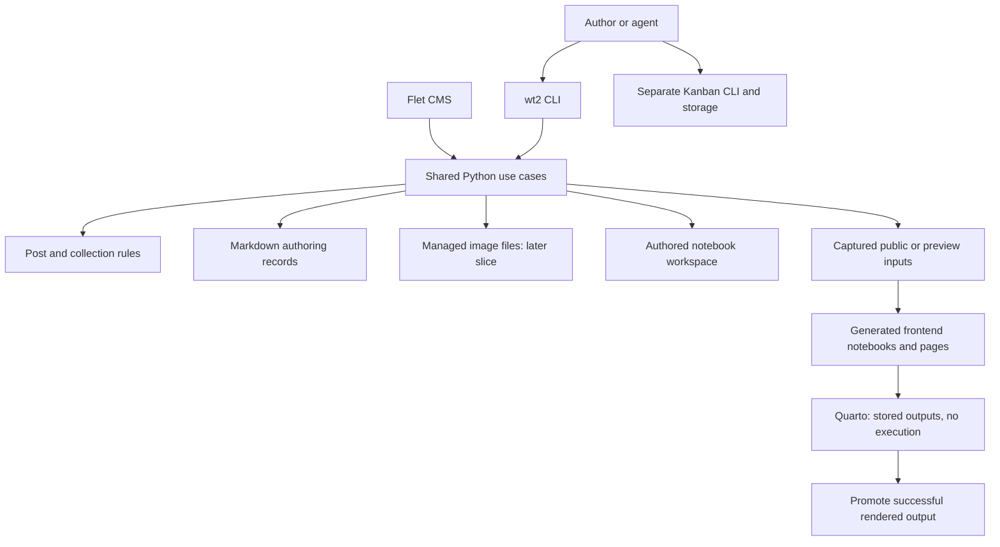

# Target architecture

[Plan index](README.md) · [Content model](content-model.md)

**Revised 2026-10-21.** One local application serves notebook posts and ordered
collections through the independent `wt2` CLI and a declarative Flet CMS.
Kanban is a separate CLI tool with independent persistence. The domain does not
contain a board, cards, course contracts or writing-plan consumption.

This is an isolated prototype. The [first slice](first-slice.md) implements draft
posts through CLI/Flet with a Markdown store. Later image/collection/rendering
components below remain proposals. Active v1 stores and publishing targets are
never implicit defaults.

## Application shape

Flet and CLI adapters call typed application use cases directly; neither parses
the other's output. Keep domain models independent of Flet, SQL clients, storage
SDKs and Quarto. A separate HTTP API server is not required before either local
interface works. Add an adapter only when an actual caller needs it.

Start with metadata, managed images, source workspace and rendering boundaries.
Use ordinary modules in one application. Do not create an abstract artifact
framework or a service for every table. Introduce durable external-operation
records only as uploads, source writes or builds require recovery.

## Authorities and storage choice

| Information | Authority |
| --- | --- |
| Post and collection fields | Markdown records with YAML front matter, accessed through shared services. Collections remain to be implemented. |
| Internal scratch notes and to-dos | Scratch and checkbox To-dos sections in those Markdown records; omitted from public projections. |
| Notebook body, outputs, inline attachments and cell options | Authored `.ipynb` file in the configured source workspace. |
| Supporting code | Repository directory referenced by optional `code_path`; may be shared by posts. |
| Thumbnails and collection covers | Verified bytes in the chosen managed image store. |
| Home and Resume | Dedicated page inputs; editable schema remains open. |
| Generated notebooks, pages, cache and rendered sites | Ignored build/runtime directories; disposable under retention rules. |
| Kanban tasks and files | Separate tool, CLI and storage outside Watchtower2. |

Markdown authoring is now selected. No SQLite or hosted metadata database.
Each record contains YAML front matter and Markdown scratch/checklist sections.
The first store uses stable per-ID filenames, exact-byte revisions and checked
atomic file installation under an advisory workspace lock.

Real records can be committed in Git. Public metadata and scratch edits produce
readable text diffs. The ignored demo workspace is disposable; runtime locks,
caches and generated output stay outside authored history. Images remain binary
files; managed-image layout and backup/release transport are later decisions.

The first store validates known fields, duplicate YAML keys, timestamps, safe
paths and exact related IDs. It preserves malformed/unknown records for repair.
Related IDs and future collection membership are ordered lists in each record,
not duplicated tables or a separate relationship database. To-dos are ordinary
Markdown checkbox lines. The logical CLI context reconstructs the unified model.

## Public projection and authoring data

The logical schemas live in the [content model](content-model.md). Persisting a
field does not mean it belongs on the frontend. Use an explicit allowlist when
generating public pages or a release manifest.

Public inputs include titles, descriptions, post tags, image references,
source/code links, eligible ordered related links and memberships, and public dates. Internal notes,
to-dos, edit revisions, recovery records and credentials are excluded. Never
serialize an entire authoring record and merely hide internal fields with CSS.

`created_at` stays fixed after creation. `updated_at` tracks public content
changes, including notebook edits; internal scratch/checklist edits leave it
unchanged. Every accepted internal save still advances the enforced edit
revision. An internal-only edit must not change the exported public digest by
leaking that revision or a broad workspace generation into the manifest.

The initial date convention proposed is UTC storage and site-timezone display.
Source digests can detect notebook changes during a watcher event or explicit
refresh before preview/release. Exact observation and timestamp semantics for
edits while the CMS is closed remain open. Missing source is a readiness error,
not a reason to erase the record or invent a new modification date. Supporting
code-change propagation to post dates remains open as well.

## Identity, references and saves

IDs never change. The write API rejects identity/date patches and derives a
permanent record filename from the ID. Changing title or source path keeps that
filename. Several posts may share code; several collections may share a post.

A save carries the SHA-256 revision of the exact record bytes read. Supported
writers acquire a workspace lock, re-read and compare, validate, stage complete
bytes and install atomically. A stale save changes nothing and preserves entered
values for review. Notes and checklist saves use the same revision check despite
leaving the public modified date unchanged. No-op saves preserve bytes/revision.

A future collection edit can keep metadata, notes/checklist, image reference and
member order in one Markdown record. That makes an ordinary edit one file save.
Deletion/reference repair across records still needs a reviewed recoverable
operation design; file-based authoring does not make multi-file changes atomic.

Related links reject unknown IDs, duplicate links and self-links; reciprocal links
between distinct posts are allowed. Source paths are unique per post, while
code paths may be shared. Validation touches the edited record and dependencies
it changes. A broken unrelated record does not block a known post's scratch edit.
Publication/release later validates the selected public dependency set.

POSIX advisory locking initially supports macOS/Linux. Direct IDE saves do not
participate in the lock and retain a final check-to-replace race. Pause affected
external saves for strict coordination. Git merging/reverting files is explicit
external work, not an automatic stale-write retry or database synchronization.

## Managed images

`thumbnail_path` and `cover_path` are author-facing logical references. Flet
provides Upload/Replace and a preview. Physical directory paths or B2 key/version
identities belong behind the image adapter, not in required authoring controls.

1. Validate image bytes and the configured size/type limits. Those limits remain
   to be agreed; the earlier v1 limits are reference, not an automatic contract.
2. Stage or upload under a unique immutable identity. Verify its bytes/digest.
3. Recheck the entity revision and finalize the image reference with its metadata.
4. Leave the previous image/reference intact after a failed replacement. An
   unreferenced staged image is recoverable or collectible after its grace period.

Never expose a reference as ready before bytes are verified. A failed or stale
metadata save may leave staging to clean up, but cannot break the saved image.
Local staging and remote uploads need explicit recovery at their store boundary.
Shared image bytes, retained releases and backups all protect their versions.

## Content notebooks and frontend notebooks

| Layer | Ownership |
| --- | --- |
| Authored notebook | Canonical body, outputs, attachments and cell options. Edit in VS Code/Jupyter or future supported notebook CLI operations. |
| Frontend notebook | Generated copy with document metadata, wrappers and rewritten links. Lives inside an ignored build stage. |
| Rendered frontend | HTML and site assets, promoted only after a successful render. |

Preview captures saved source plus current eligible CMS metadata and images.
Production captures source/configuration hashes and an allowlisted frozen release.
Generate frontend notebooks and other pages from those captured inputs, then
render stored outputs with execution disabled. Builds never inject metadata into
canonical sources. Collection pages and listings are generated pages, not a
second authored notebook for each collection.

Title/H1 projection details and public route conventions need implementation
review; source notebooks continue to own their authored headings. Preserve cell
visibility/folding options. Explicit notebook execution must save outputs only
when source bytes still match the captured revision; preserve conflicting results
for inspection instead of overwriting an IDE edit.

Source creation and managed path changes need expected absence/preimage checks,
recoverable staging and a metadata revision check. A draft can be saved before
its intended source exists. Creating an empty notebook must not seed a writing
brief or overwrite a file. Referencing code never scaffolds or deletes it.

## Workspace and operations

Start with an explicitly selected authoring workspace. Records and authored
sources can travel through Git; commits, branch merges and conflict resolution
remain explicit. Tests/worktrees receive isolated records and source copies,
with separate generated/runtime paths. Do not silently bind another process to
active v1 authoring files. The Markdown workspace marker records schema,
environment and immutable workspace identity without machine-absolute paths.

Record-format upgrades need explicit version checks and preservation of original
files. Refuse unsupported schemas instead of rewriting them. Future multi-file
upgrades need coordinated recovery; the first slice only validates schema 1 and
never auto-migrates records. The additive `tags` field is optional on older
schema-1 post files and reads as an empty list without rewriting the file.

Managed image deletion and cleanup go through the application backend. Authored
notebooks and shared code are not build garbage. Proposed initial deletion
behavior retains source files and reviews incoming links before removing records;
exact undo/cascade rules remain open. See [retention](retention-and-gc.md).

Run cleanup at startup, after relevant operations and during active sessions, or
explicitly through CLI. No always-on GC host is required. Preserve active render
leases, current/fallback output and unresolved recovery data.

Keep secrets in the OS keyring and any future CI secret store. Preserve safe
paths and localhost host/origin checks. The CMS remains local; hosting it would
require a separately designed authentication and remote-workspace boundary.

## Preview and deliberate publication

Draft/Published is authoring eligibility. Publishing a collection does not
publish its posts; drafting a collection does not hide an independently published
post. Public output includes published members/related links in stored order.
The collection validation edge cases remain in the content model's open choices.

Retain the prior frozen-release design: production builds use committed,
allowlisted public metadata and matching authored sources/assets, without reading
mutable live CMS records. The chosen image store must provide the captured exact
bytes, locally packaged or remotely versioned. Internal scratch edits cannot
change an existing release. Record the deployed release separately from content
status and preserve the last successful output on failure.

Demonstrate deployment only in isolated targets. No current workflow, Pages
setting, domain or v1 store changes under this prototype. See
[website deployment](website-deployment.md) and [operations](migration-and-operations.md).
