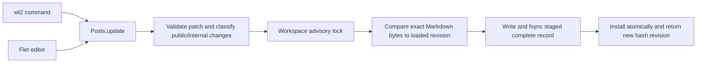

# First slice: Markdown-backed draft posts

[Plan index](README.md) · [Content model](content-model.md) · [CLI and Flet](cli-v2-and-flet.md)

**Implemented 2026-10-21.** Start writing with a draft record, optional scratch
and checkbox list. The metadata store is Markdown. There is no SQLite, hosted
database, embedded Kanban, mandatory plan or automatic notebook prose seeding.
This is an isolated development slice, not an adopted replacement for v1.

## Decision and stored changes

The user selected Markdown for authoring during implementation. This supersedes
the earlier Turso direction and the suggested SQLite alternative. Metadata and
scratch saves intentionally produce readable Git changes in a tracked authoring
workspace. The ignored demo workspace is disposable evidence, not the real store.

One immutable ID maps to one permanent `posts/<identifier>.md` filename. Public
metadata is YAML front matter; internal notes and ordered to-dos are Markdown.
For example, a saved record has this shape:

```markdown
---
id: post/ca8c0d8c66534c0ab3caf773d586f44e
status: draft
title: Understanding Attention
short_description: ''
tags: []
thumbnail_path: null
source_path: content/posts/ca8c0d8c66534c0ab3caf773d586f44e.ipynb
code_path: null
related_post_ids: []
created_at: '2026-10-21T02:00:00+00:00'
updated_at: '2026-10-21T02:00:00+00:00'
---
## Scratch

Try a smaller example first.

## To-dos

- [ ] Add the example
- [x] Choose a title
```

The YAML examples in the content model are logical API records. On disk,
`internal_notes` and `internal_todos` are represented by these two Markdown
sections, not duplicated in front matter. Scratch may contain arbitrary Markdown,
including its own headings; the final To-dos section is the checklist. Each task
occupies one line. The CLI rewrites metadata in a canonical format, preserves
scratch text, and refuses malformed/duplicate/unknown fields rather than erasing
them. CRLF records are readable; text is normalized to LF on a subsequent edit.
Older schema-1 records without `tags` read as `[]` without a migration or rewrite.
Their next actual save adds the field; an internal-only save still preserves the
public modification date.

The workspace also has `.wt2/workspace.md` for its schema/environment/identity and
an ignored `.wt2/writer.lock`. No database/index file stores authoring state.
The marker has no machine-absolute paths, so a cloned/copied complete workspace
can be explicitly opened elsewhere; it recreates its local ignored lock.

A new draft creates only its metadata record, assigning an intended `.ipynb` path.
It does not create the notebook, project directory, image or any public page.
Changing title never changes ID, record filename or notebook path.

## Trace one save



The enforced revision is `post:<sha256 of exact record bytes>`. A direct Markdown
edit invalidates a loaded revision as well. Supported CLI/UI writers coordinate
through the workspace lock. A stale edit is rejected without resubmission; the
editor keeps its entered values and original revision until explicit discard/reload.

The application advances public `updated_at` only when supported public metadata
changes. Scratch and checklist changes alter record bytes/revision but leave
public metadata and dates identical. A no-op save leaves bytes/revision unchanged.
Validation touches the edited post and dependencies it changes; a broken unrelated
record does not prevent a known post's scratch update.

## Runnable CLI

From `projects/watchtower2/` after `uv sync`:

```bash
.venv/bin/wt2 --workspace .runtime/demo init --environment demo
.venv/bin/wt2 --workspace .runtime/demo post create --title "Understanding Attention"
.venv/bin/wt2 --workspace .runtime/demo post ls
.venv/bin/wt2 --workspace .runtime/demo post show post/RETURNED_ID
```

Creation and reads return JSON containing `post` and `revision`. Prepare a patch
in `.tmp/patch.json`, using that returned ID and exact revision:

```json
{
  "internal_notes": "Try a smaller example first.",
  "internal_todos": [{"text": "Add the example", "done": false}]
}
```

```bash
.venv/bin/wt2 --workspace .runtime/demo post update post/RETURNED_ID   --patch-file .tmp/patch.json --expected-revision post:RETURNED_HASH
```

The JSON file is a request payload, not the persisted authoring format. Editable
fields are title, short description, tags, notebook path, optional code path, ordered
related IDs, internal notes and to-dos. IDs, dates, status and thumbnail references
cannot be patched in this slice. Publication/image workflows have not arrived.
Errors are JSON on stderr: validation/I/O exits 2, conflict 3, missing post 4.
Successful data is JSON on stdout. Every invocation requires an explicit workspace.

Set public tags with a patch such as `{"tags": ["python", "transformers"]}`;
use `{"tags": []}` to clear them. Labels are trimmed and exact duplicates removed,
preserving capitalization and order. Labels must be nonempty single-line text
without commas. Tag changes advance the public date; an equivalent normalized
list is a no-op. There is no separate tag registry or taxonomy.

## Optional Flet editor

Install with `uv sync --extra gui`, then run:

```bash
.venv/bin/wt2 --workspace .runtime/demo gui --port 4310
```

The declarative screen creates/selects drafts and edits metadata (including a
comma-separated Tags field), scratch and checklists. Saves use the same service
as CLI. To-dos support add, edit,
check, remove and explicit Up/Down. Related IDs are editable through the CLI in
this slice; the GUI selector is still pending. Dirty forms block switching or
creating another post. Discard edits and reload is an explicit action. An unsaved
new checklist line is included on Save.

Network/file work runs outside the UI event loop. The server binds to loopback
and rejects nonmatching Host/Origin, including WebSocket connections. It does not
serve the content workspace as an assets directory.

Flet 1.0.4's web adapter passes legacy FastAPI constructor arguments. Startup
failed with resolved FastAPI 0.157.0 and 0.156.8; the GUI extra now pins the tested
compatible 0.141.1. The project lockfile records exact versions. Headless installs
need only PyYAML and do not import Flet. This pin applies to the prototype only.

## Evidence and limitations

The file/CLI tests cover immutable identity, unchanged public dates after internal
edits, stable no-ops, competing writers, direct-file revision conflicts, scoped
validation, tag normalization/clearing and older untagged records, ordered related
IDs, shared code paths, source uniqueness, malformed record preservation, failed
installation and symlink rejection. Editor tests
cover retained input after validation/conflict, checklist ordering, explicit
discard, control construction against the installed Flet API and the local
HTTP/WebSocket boundary. See [tests](../tests/).

Verification on 2026-10-21: all 34 project tests pass; repository lint passes;
project-local type checking reports zero errors. A real CLI server returned the
Flet HTTP shell with status 200 and rejected foreign Host/Origin with 403; the
test server was stopped afterward. The editor rejects inherited FLET_ASSETS_DIR
or FLET_UPLOAD_DIR values because Flet otherwise overrides explicit asset settings.

The repository-wide baseline was already failing: type checking reports 45 errors
in `projects/text-decisions`, and the v1 test suite has 206 failures/574 passes,
mainly from missing `python-multipart` and sandboxed socket/kernel operations.
Those checks do not indicate a passing v1 suite; the prototype has its own checks.
No v1 application behavior was changed to mask those failures.

The browser-control runtime had no connected browser. The HTTP shell and editor
state/callbacks were checked programmatically; visual rendering, focus/keyboard
behavior, client disconnection and real browser re-render behavior remain
unverified. Stage 1 is not marked fully accepted on the strength of unit checks.

Current platform support is macOS/Linux, using POSIX advisory locking. Direct IDE
saves do not participate in that lock; a final check-to-replace race remains.
Pause affected editor saves when strict coordination is needed. A manually changed
public front-matter field also needs its public date maintained until change
reconciliation is implemented; scratch/checklist edits naturally leave it alone.

Notebook changes are not observed yet. Source creation/execution, managed image
validation, publication, collections, public rendering/release and deletion/undo
are future slices. No source notebook or shared code is modified by this one.
