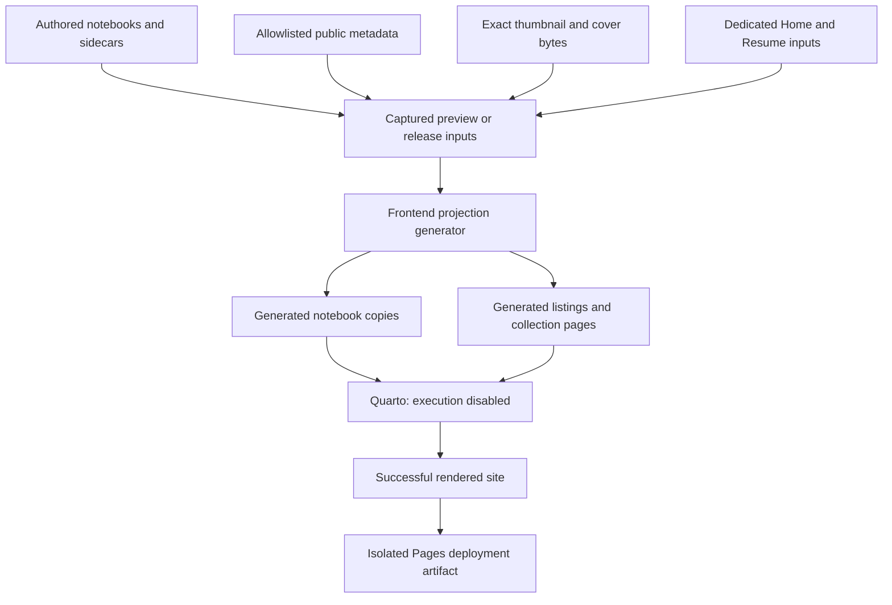

# Website preview and deployment

[Plan index](README.md) · [Content model](content-model.md) · [Architecture](architecture.md)

**Revised 2026-10-21.** Generate a public site with Home, Resume, Posts and
Collections. Posts render from authored notebooks and appear in a thumbnail
listing. Collections render from metadata and ordered post IDs, with cover cards
in a grid. Home/Resume editing inputs remain to be designed.

Retain the earlier proposal to build from frozen public release inputs and deploy
rendered HTML/assets through a GitHub Pages Actions artifact. This is not an
implemented workflow. The current [v1 workflow](../../../.github/workflows/publish.yml)
continues to publish through its existing configuration. All prototype deployment
experiments use isolated targets; the live workflow, Pages settings and domain
remain outside this plan.

## Content to frontend

Authored notebooks own body cells, outputs, attachments and cell options. Generated
copies receive document metadata, wrappers and link projection. The generator
never writes back to source. Collection pages and listings need no authored
notebook. Render stored outputs with kernel execution explicitly disabled.

Thumbnail/cover paths are logical references to verified bytes. Authoring metadata is
Markdown. Managed image layout/hosting is still a later choice: local images need
a deliberate packaging/retention route to CI; any eventual remote images need
exact retained bytes and scoped read access.
Do not make CI depend on a directory available only on the author's laptop.

## Preview and publication eligibility

Working preview reads saved draft/published records and source files. It may show
missing-source/image diagnostics and draft badges. Public release mode includes
published posts/collections only, filters related links and collection memberships
to published posts and preserves their stored order.

Publishing a collection never publishes its members. Drafting a collection does
not hide an independently published post. A published post requires meaningful
notebook content, title, short description and a valid thumbnail. Exact collection
publication requirements and the no-published-members case remain open in the
content model; resolve them before implementing release validation.

Parse authoring Markdown into the logical model, then allowlist public fields.
Do not deploy the raw metadata/scratch Markdown files. Public snapshots hash the
public projection, not whole authoring records that also contain internal text.
The public projector excludes notes, to-dos, edit revisions and recovery records. Kanban is independent and is not a build input. A scratch/checklist-only
save cannot change public dates or exported public metadata/hash indirectly through
a global workspace or entity edit revision.

## Save, commit and deploy

| Action | Proposed effect |
| --- | --- |
| Save metadata, scratch or checklist | Update the Markdown record, producing a readable Git diff when tracked. No deployment or automatic release export. |
| Save an authored notebook | Change source. Explicit execution is separate. |
| Build working preview | Capture saved inputs, generate copies and render locally. |
| Prepare release | Validate public inputs, freeze metadata/source/image/configuration hashes and export a reviewable manifest. |
| Commit matching source and manifest | Record a deliberate publication snapshot in Git. |
| Deploy selected release | Build its matching commit/snapshot and promote successful output. |

The prior recommendation remains release-specific deployment: ordinary code/content
merges run checks; an explicitly selected new release triggers deployment. Prove
that trigger in a separate prototype workflow before considering live adoption.
`published` means eligible for a release; the deployed release ID records what is
actually live and belongs in application/release status, not another editable
post field.

## Prepare and build a frozen release

1. Capture an explicit coherent set of published metadata and saved source,
   including dedicated Home/Resume inputs and template/toolchain identity.
2. Validate referenced notebooks, thumbnails/covers, links and routes. Record
   source/sidecar/configuration hashes and exact image identities/digests.
3. Protect selected image versions before exporting the manifest. Reconcile
   interrupted exports rather than dropping possibly committed/deployed pins.
4. Export only allowlisted public data for review and commit with matching sources.
5. CI checks out the selected commit, verifies captured inputs, obtains exact images,
   generates frontend copies/pages, renders and validates output.
6. Deploy only the rendered public site and record its receipt/outcome.

CI never queries mutable authoring records or needs a running CMS. A later metadata
or scratch edit cannot mutate the selected release. Public site browsing requires
neither the author's laptop nor mutable authoring records.

Bind manifest digest to the matching source commit in a release receipt; avoid a
manifest containing its own enclosing commit hash. Rebuilding an older release
uses its recorded commit, not current `main` with old hashes. Retries reuse the
same release identity and pins. Byte-identical HTML across arbitrary toolchains
is not promised; preserve the tested rendering inputs and toolchain.

## CI authentication

No image provider has been reselected in this revision. If B2 remains, give the
hydration job a dedicated read-only key limited to site inputs and required
retained versions. Give it no authoring-record access, upload, deletion or backup
credential. Test exact-version retrieval with those permissions.

Keep local credentials in the OS keyring and future CI credentials in protected
Actions secrets. Nonsecret endpoint/bucket configuration belongs in configuration.
Untrusted validation uses fixtures or isolated resources without production secrets.
No credentials enter manifests, notebook copies, browser assets or diagnostic logs.
A local-storage choice needs an equally explicit image handoff without granting
CI access to the author's whole workspace.

## Failure, rollback and retention

Missing images, source/hash mismatch or rendering errors fail the candidate while
preserving the last successful output. Prevent an older queued deployment from
replacing a newer intended release. Record the selected and actually deployed
release identities for diagnosis.

Drafting/deleting content changes the next candidate, not an existing static site.
Withdrawal requires deploying a new release. Image deletion is not a withdrawal
mechanism. Rollback uses a retained release, its matching commit and exact bytes,
without reconstructing metadata from today's editable records.

Retain current/rollback releases and named pins under the agreed retention policy.
Generated notebook copies, hydrated files, logs and output share their build stage's
lease and bounded retention. Canonical sources stay outside build cleanup. Git
history alone does not promise that every old manifest remains rebuildable.

Demonstrate source immutability, internal-field exclusion, scratch-only digest
stability, draft filtering, clean-checkout generation, failure preservation and
rollback in isolated resources before adoption. No prototype test publishes over
the current website.
